<div align="center">

# FO's Homelab
Everything that runs the 🪿 geese clusters, declared in code.

</div>

<div align="center">


</div>

<div align="center">

![Kubernetes][k8s-shield]
![Proxmox][proxmox-shield]
![Terraform][terraform-shield]
![Talos][talos-shield]
![Flux][flux-shield]

</div>

## Overview

My homelab as code. Terraform builds the Proxmox VMs and one Talos Kubernetes cluster, `k8s-geese`. Flux deploys everything else from this repo.

> **What is a homelab?**
>
> Why rent the cloud when you can build your own? A homelab lets you self-host services, experiment freely, and get hands-on practice for certifications, right from your home.

## Apps

| App | What | URL |
|---|---|---|
| [Vaultwarden](https://github.com/dani-garcia/vaultwarden) | Password manager | `vaultwarden.lab.felixlatulip.ca` |
| [Sure](https://github.com/we-promise/sure) | Personal finance | `sure.lab.felixlatulip.ca` |
| [Obsidian LiveSync](https://github.com/vrtmrz/obsidian-livesync) | Obsidian vault sync (CouchDB) | `obsidian.lab.felixlatulip.ca` |
| hello | Test page, public (DMZ) | `hello.felixlatulip.ca` |

## Network Topology

```mermaid
---
config:
  theme: base
  flowchart:
    htmlLabels: true
    curve: basis
    nodeSpacing: 30
    rankSpacing: 22
    padding: 10
    subGraphTitleMargin:
      top: 6
      bottom: 6
  themeVariables:
    darkMode: true
    background: "#141414"
    fontFamily: "Inter, Segoe UI, Helvetica, Arial, sans-serif"
    fontSize: 15px
    primaryColor: "#1f1f1f"
    primaryTextColor: "#f2f2f2"
    primaryBorderColor: "#555"
    lineColor: "#8a8a8a"
    clusterBkg: "#1b1b1d"
    clusterBorder: "#3a3a3d"
    titleColor: "#f2f2f2"
---
flowchart TB
    NET["<div style='width:170px;text-align:center;line-height:1.35'><b>Internet</b></div>"]
    GW["<div style='width:200px;text-align:center;line-height:1.35'><b>Router</b></div>"]
    WIFI["<div style='width:150px;text-align:center;line-height:1.35'><b>VLAN10</b><br/>Wi-Fi</div>"]
    IOT["<div style='width:150px;text-align:center;line-height:1.35'><b>VLAN30</b><br/>IoT</div>"]

    NET ==> GW
    GW --> WIFI
    GW --> S1
    GW --> S2
    GW --> NAS
    GW --> IOT

    subgraph NAS["<b>goose-nas (Unraid)</b>"]
        direction TB
        H3["<div style='width:200px;text-align:center;line-height:1.35'>i9-9900K · 16GB · 32TB</div>"]
        PBS["<div style='width:200px;text-align:center;line-height:1.35'><b>PBS</b><br/><small>VM · 3GB</small></div>"]
        QDEV["<div style='width:200px;text-align:center;line-height:1.35'><b>QDevice</b><br/><small>VM · quorum</small></div>"]
        H3 ~~~ PBS ~~~ QDEV
    end

    subgraph S2["<b>goose2</b>"]
        direction TB
        H2["<div style='width:200px;text-align:center;line-height:1.35'>i5-6500T · 20GB · 2.5GbE</div>"]
        HAOS["<div style='width:200px;text-align:center;line-height:1.35'><b>HAOS</b><br/><small>VM · 3GB</small></div>"]
        UOS["<div style='width:200px;text-align:center;line-height:1.35'><b>UniFi OS Server</b><br/><small>VM · 3GB</small></div>"]
        PDM["<div style='width:200px;text-align:center;line-height:1.35'><b>PDM</b><br/><small>LXC · 1GB</small></div>"]
        K8TW["<div style='width:200px;text-align:center;line-height:1.35'><b>k8s-geese-w1</b><br/><small>Worker · 6GB</small></div>"]
        K8D2["<div style='width:200px;text-align:center;line-height:1.35'><b>k8s-geese-dmz2</b><br/><small>DMZ worker · 3GB</small></div>"]
        H2 ~~~ HAOS ~~~ UOS ~~~ PDM ~~~ K8TW ~~~ K8D2
    end

    subgraph S1["<b>goose</b>"]
        direction TB
        H1["<div style='width:200px;text-align:center;line-height:1.35'>i5-8600K · 24GB · 10GbE</div>"]
        K8TCP["<div style='width:200px;text-align:center;line-height:1.35'><b>k8s-geese-cp1</b><br/><small>CP + worker · 12GB</small></div>"]
        K8D1["<div style='width:200px;text-align:center;line-height:1.35'><b>k8s-geese-dmz1</b><br/><small>DMZ worker · 3GB</small></div>"]
        H1 ~~~ K8TCP ~~~ K8D1
    end

    subgraph LEGEND[" "]
        direction LR
        L1["<div style='width:150px;text-align:center;line-height:1.35'>Mgmt · VLAN1</div>"]
        L2["<div style='width:150px;text-align:center;line-height:1.35'>Trusted · VLAN20</div>"]
        L3["<div style='width:150px;text-align:center;line-height:1.35'>DMZ · VLAN50</div>"]
        L1 ~~~ L2 ~~~ L3
    end
    S2 ~~~ LEGEND

    classDef core fill:#1f1f22,stroke:#6b6b70,stroke-width:1.5px,color:#f5f5f5,rx:10,ry:10
    classDef hdr fill:transparent,stroke:transparent,color:#a8a8ad
    classDef mgmt fill:#3d3d3a,stroke:#9a9a94,stroke-width:1.5px,color:#e8e8e3,rx:10,ry:10
    classDef trusted fill:#0b4d3f,stroke:#3fd1a2,stroke-width:1.5px,color:#c9f5e6,rx:10,ry:10
    classDef dmz fill:#7a2d14,stroke:#ff8a5c,stroke-width:1.5px,color:#ffd9c9,rx:10,ry:10

    class NET,GW core
    class H1,H2,H3 hdr
    class WIFI,IOT,UOS,PDM,L1 mgmt
    class K8TCP,K8TW,HAOS,PBS,QDEV,L2 trusted
    class K8D1,K8D2,L3 dmz

    style S1 fill:#1b1b1d,stroke:#3a3a3d,stroke-width:2px
    style S2 fill:#1b1b1d,stroke:#3a3a3d,stroke-width:2px
    style NAS fill:#1b1b1d,stroke:#3a3a3d,stroke-width:2px
    style LEGEND fill:transparent,stroke:transparent

    linkStyle 0 stroke:#3fd1a2,stroke-width:3px
```


## Cluster

One cluster, `k8s-geese`, with two kinds of nodes ([ADR 0001](doc/adr/0001-single-cluster-cilium.md)):

- **Trusted nodes** (VLAN 20) run the LAN-only apps, Longhorn and the control plane.
- **DMZ nodes** (VLAN 50) only run public apps, reached through a Cloudflare Tunnel. They're tainted, and Cilium network policies stop DMZ pods and nodes from reaching anything trusted. VLAN 50 is also firewalled from the LAN, in case a policy is wrong.

Cilium is the CNI (no kube-proxy, no MetalLB). There's one node of each kind per Proxmox host. The control plane also runs workloads. Since I would need three CP, as per etcd requirements, HA is currently not achieved. The addition of an offsite CP is part of my [roadmap](doc/roadmap.md).

| Node | IP | Zone | Role | Host | RAM |
|---|---|---|---|---|---|
| k8s-geese-cp1 | 10.10.20.60 | trusted | control plane + worker | `goose` | 12 GB |
| k8s-geese-w1 | 10.10.20.61 | trusted | worker | `goose2` | 6 GB |
| k8s-geese-dmz1 | 10.10.50.60 | dmz | worker | `goose` | 3 GB |
| k8s-geese-dmz2 | 10.10.50.61 | dmz | worker | `goose2` | 3 GB |


## Deployment

**1. Build the VMs and the cluster** (UniFi firewall rules first, see the rebuild doc)

```sh
terraform -chdir=terraform apply
terraform -chdir=terraform output -raw geese_kubeconfig > ~/.kube/config
```

**2. Install Cilium** (the nodes stay `NotReady` until there's a CNI)

```sh
scripts/bootstrap-cilium.sh admin@k8s-geese
```

**3. Add the sops key** (before Flux, or secrets fail to decrypt)

```sh
kubectl create namespace flux-system
kubectl -n flux-system create secret generic sops-age \
  --from-file=age.agekey="$HOME/Library/Application Support/sops/age/keys.txt"
```

**4. Install Flux** from `kubernetes/cluster/flux-system/` with a read-only deploy key. Flux then takes over Cilium and deploys everything else.

Exact commands in [doc/rebuild.md](doc/rebuild.md#creating-k8s-geese).

## Workflow

Flux watches `main`. Merge a PR and it's live within a minute. Delete a file and Flux deletes it from the cluster.

```sh
flux reconcile kustomization flux-system --with-source   # sync now
flux get kustomizations                                  # status
```

Cluster values like `TRAEFIK_IP` are set in `kubernetes/cluster/infrastructure.yaml`.

## Adding an App

```sh
app=myapp
cp -r doc/templates/helm-app kubernetes/apps/trusted/$app
sed -i '' "s/APP_NAME/$app/g" kubernetes/apps/trusted/$app/*.yaml
```

1. Fill in the chart and `values:` in `helmrelease.yaml`.
2. Encrypt the secret: `sops -e -i kubernetes/apps/trusted/$app/secret.sops.yaml`.
3. Add `$app` to `kubernetes/apps/trusted/kustomization.yaml`.
4. Open a PR.

> Full guide: [doc/adding-an-app.md](doc/adding-an-app.md).

## Docs

| Doc | Covers |
|---|---|
| [Adding an app](doc/adding-an-app.md) | Helm template, step by step |
| [Operations](doc/operations.md) | health checks, kubeconfig |
| [Workflow](doc/workflow.md) | PRs, CI, commit rules |
| [Networking](doc/networking.md) | VLANs, IPs, certs, tunnel |
| [Storage](doc/storage.md) | Longhorn, NAS backups |
| [Secrets](doc/secrets.md) | sops + age, key recovery |
| [Talos](doc/talos.md) | 1.14 quirks, upgrades |
| [Rebuild](doc/rebuild.md) | disaster recovery |
| [Sure](doc/runbooks/sure.md) | backups, restore, upgrades |
| [cert-manager to Helm](doc/runbooks/cert-manager-helm-migration.md) | one-time takeover of the static manifest |
| [ADR 0001](doc/adr/0001-single-cluster-cilium.md) | one cluster with Cilium (accepted) |

## Roadmap

Full roadmap available here: [doc/roadmap.md](doc/roadmap.md).

## Thanks and Gratitudes

- [Serge Latulippe](https://github.com/happytechca), for all the invaluable knowledge and equipment that he provided over the years
- [Eliza Wang](https://github.com/wca-eliza), for not strangling me over the pile of networking equipment taking over our closet
- [bjw-s helm charts](https://github.com/bjw-s-labs/helm-charts), for app-template inspirations
- [homarr-labs/dashboard-icons](https://github.com/homarr-labs/dashboard-icons), for the diagram icons
- [kubesearch.dev](https://kubesearch.dev), for finding how others deploy the same apps

## Contributing

Any contributions you make are **greatly appreciated**.

If you have a suggestion that would make this better, please see [contributing guide](https://github.com/folatulip/homelab?tab=contributing-ov-file#contribution-guidelines) for more information.
Please also read the [code of conduct](https://github.com/folatulip/homelab?tab=coc-ov-file) and [security policy](https://github.com/folatulip/homelab?tab=security-ov-file).
Thanks again!

## Unofficial Wiki

[](https://deepwiki.com/folatulip/homelab)

## License

Distributed under the MIT License. See [license page](https://github.com/folatulip/homelab/blob/main/LICENSE) or `LICENSE.txt` for more information.

<!-- SHIELD LINKS -->
[terraform-shield]: https://img.shields.io/badge/Terraform-844FBA?style=for-the-badge&logo=terraform&logoColor=white
[k8s-shield]: https://img.shields.io/badge/Kubernetes-326CE5?style=for-the-badge&logo=kubernetes&logoColor=white
[proxmox-shield]: https://img.shields.io/badge/Proxmox-E57000?style=for-the-badge&logo=proxmox&logoColor=white
[talos-shield]: https://img.shields.io/badge/Talos-e43245?style=for-the-badge&logo=talos&logoColor=white
[flux-shield]: https://img.shields.io/badge/Flux-5468FF?style=for-the-badge&logo=flux&logoColor=white
